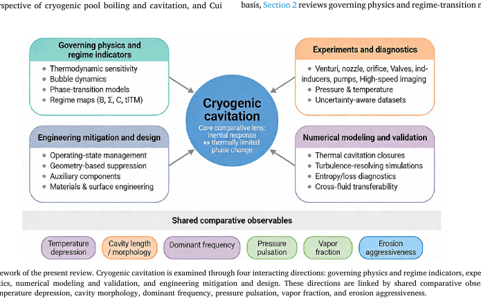
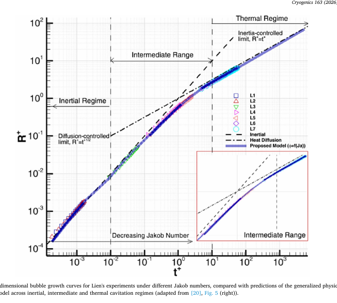
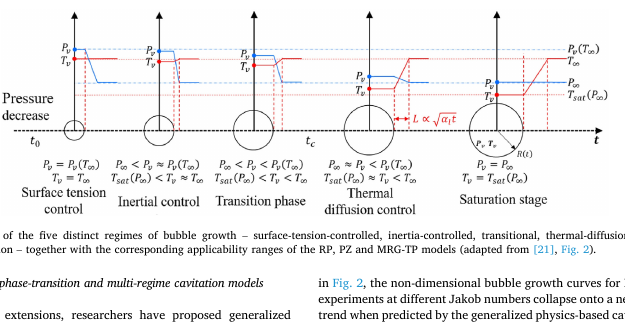
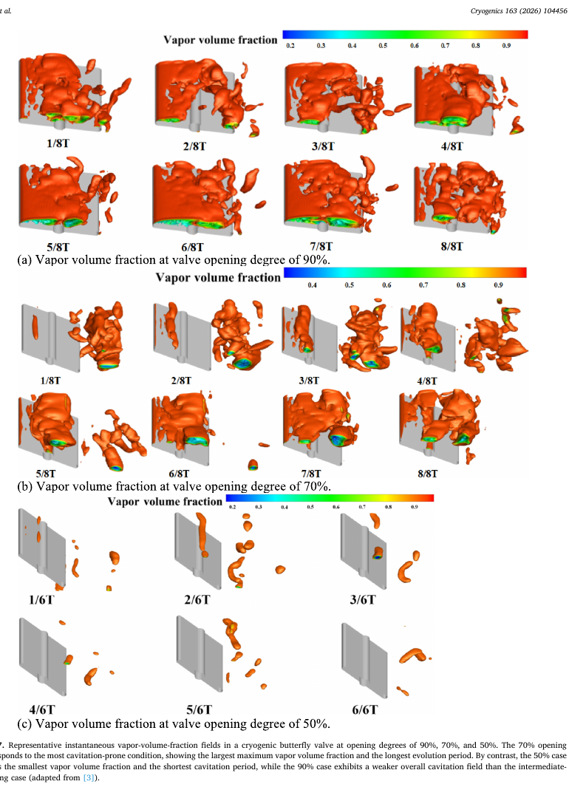
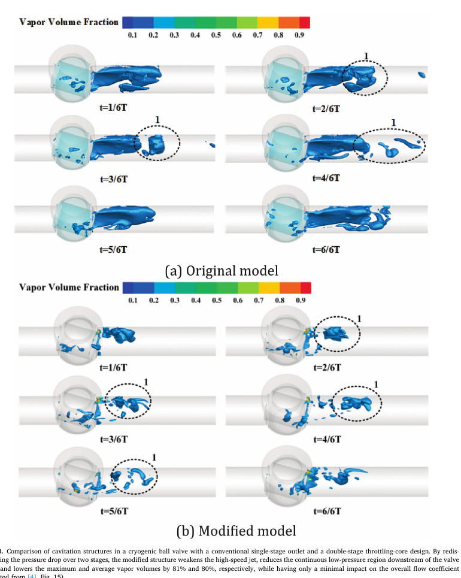

# Paperzh Reading Skill 论文分析演示

## 论文

**Cryogenic cavitation: Thermodynamic regimes, experiments, numerical modeling, and engineering control**  
Yiliang Li, Min Chai, Qing Huang, Shuihua Zheng  
*Cryogenics* 163 (2026) 104456 · DOI: 10.1016/j.cryogenics.2026.104456

本目录展示 `Paperzh Reading Skill` 对同一篇低温空化综述的两种分析模式：

- [Flash 速读报告](reports/Paperzh_Cryogenic_Cavitation_Flash.docx)：适合批量阅读和横向比较。
- [Deep 精读报告](reports/Paperzh_Cryogenic_Cavitation_Deep.docx)：适合研究决策、方法复现和课题迁移。

## 先看结论

这篇综述的核心贡献不是简单罗列低温空化文献，而是把以下链条连起来：

> 热状态与工质物性 → 相变时间尺度 → 空腔形态和非定常压力 → 数值模型闭合与验证 → 工程控制

论文最值得借鉴的判断是：低温空化不能只用传统空化数或平均空腔长度解释。惯性响应、热力学受限相变、非平衡传质、可压缩性和材料响应需要放在同一证据链中检查。

## Flash 模式快速判断

### 作者做了什么

作者将 LN2、LOX、LH2、甲烷、N2O 等低温工质的单气泡、Venturi、收缩-扩张喷嘴、孔板、阀、诱导轮和泵研究，按四条方向组织：控制物理与分区指标、实验与诊断、数值建模与验证、工程控制。论文明确定位为结构化叙事综述，而不是正式的 meta-analysis。

### 最有用的结果

| 观察 | 论文结果 | 使用边界 |
|---|---|---|
| LN2 Venturi | 压力比约高于 2.23 后出现冷凝前沿上游传播 | 特定 Venturi 与工况，不是普适阈值 |
| C-D 喷嘴 | 约 77–78 K 出现动态/形态转变；约 85 K 以上腔体更小、频率更高 | 依赖几何、压降和观测定义 |
| 单气泡 | 66–76.4 K、过冷度 0.95–11.35 K 内，破碎时间呈非线性负指数变化 | 单泡尺度不能直接代替泵/阀空腔寿命 |
| 甲烷泵 | 入口压力 0.146 MPa 时，空化周期约为 0.3 MPa 时的 5 倍 | 泵型、入口热状态和指标定义特定 |
| 双级球阀 | 最大/平均汽相体积约降低 81%/80%，流量系数影响很小 | 是特定改造方案的收益，不是通用保证 |

### 研究漏洞

1. 综述没有统一的跨论文误差包络，不同几何、尺度、工质和指标不能直接合并。
2. 许多数值研究只验证平均水力性能或腔体长度，未同时验证温降、压力谱、汽相分布、混合声速和不确定度。
3. EOS、平衡物性库、相变源项、松弛时间、湍流闭合和边界条件可能在一个工况有效，跨工况或跨工质时未必成立。
4. “机制主导”“稳定性”“增强”等概念已经有候选指标，但没有全部形成定义—测量—阈值—可复现的闭环。

## Deep 模式精读框架

Deep 报告完整执行三层阅读：

1. **Layer 1：** 重建问题、研究缺口、对象、方法、证据、结论和适用边界。
2. **Layer 2：** 阅读热力学分区、关键实验、模型策略、验证层级、工程控制，以及 Fig. 1–8 和 Tables 1–5、A1。
3. **Layer 3：** 用“主张 → 所需证据 → 已有证据 → 缺失证据 → 替代解释 → 置信度 → 边界”审查，并给出 P0/P1/P2 研究迁移计划。

## 关键图文截图

### 综述框架：四条方向和六类共同观测量

这张图说明作者试图把温度压降、空腔形态、主频、压力脉动、汽相分数和侵蚀性作为跨研究的共同语言。它适合用来建立自己的文献矩阵，但不能消除不同研究的测量定义差异。

### 惯性区间和热力学区间

图中无量纲气泡增长曲线显示，惯性区、中间区和热力学区并非简单二分。Deep 报告特别检查了 `Ja`、`PeL`、`B`、`Sigma` 和 `C` 的物理意义，并提醒参考尺度变化会改变指标数值。

五分区示意图帮助判断 Rayleigh–Plesset 类、PZ 类和 MRG-TP 类模型的适用范围。它是模型选择框架，不是已经被所有组件验证的统一相图。

### 工程控制：阀开度不是单调风险关系

论文给出的案例中，70% 开度比 90% 开度更容易产生大量汽相，50% 开度最弱。因此“阀门开得越大越安全”不能作为无条件工程规则。

### 工程控制：分级压降

双级节流把一次大压降重新分配到多个位置，论文报告最大和平均汽相体积分别降低约 81% 和 80%。Deep 报告进一步指出，这种收益必须与压头、效率、压力脉动和多个弱热点一起评估。

## 研究迁移建议

### P0

- 用同步的压力、温度、流量、高速成像和汽相/声速观测，验证模型是否同时捕捉热、相变和非定常。
- 报告传感器响应、图像阈值、重复性、网格/时间步独立性和数值源项不确定度。

### P1

- 在同一几何和无量纲流动条件下比较 LN2、LOX、LH2 或 CH4，检验哪些趋势可跨工质迁移。
- 统一比较 HRM/非平衡模型、EOS/物性库和 RANS/LES/DDES，不以分辨率代替闭合验证。
- 对分级压降做级数、级间距和压降比的 Pareto 分析，而不是引用一个固定降幅。

### P2

- 把侵蚀、材料表面状态、压力脉冲和汽相时空分布连接起来。
- 研究启动、停机、阀冲击和冷凝冲击等稳态之外的瞬态安全判据。

## 证据与版权说明

截图来自用户提供的论文 PDF，用于本次学术阅读演示；原始图注和来源信息保留在图片及 Word 报告中。公开仓库继续传播这些截图前，应根据期刊和版权许可要求确认是否需要替换为仅保留分析者自制的示意图。

本次分析独立核对了提供 PDF 的全文文本、页面渲染和关键图表，但没有重新运行论文引用的原始模型，也没有对引用文献做完整 meta-analysis。跨论文的真实性、误差和可复现性判断应以原始论文为最终依据。
